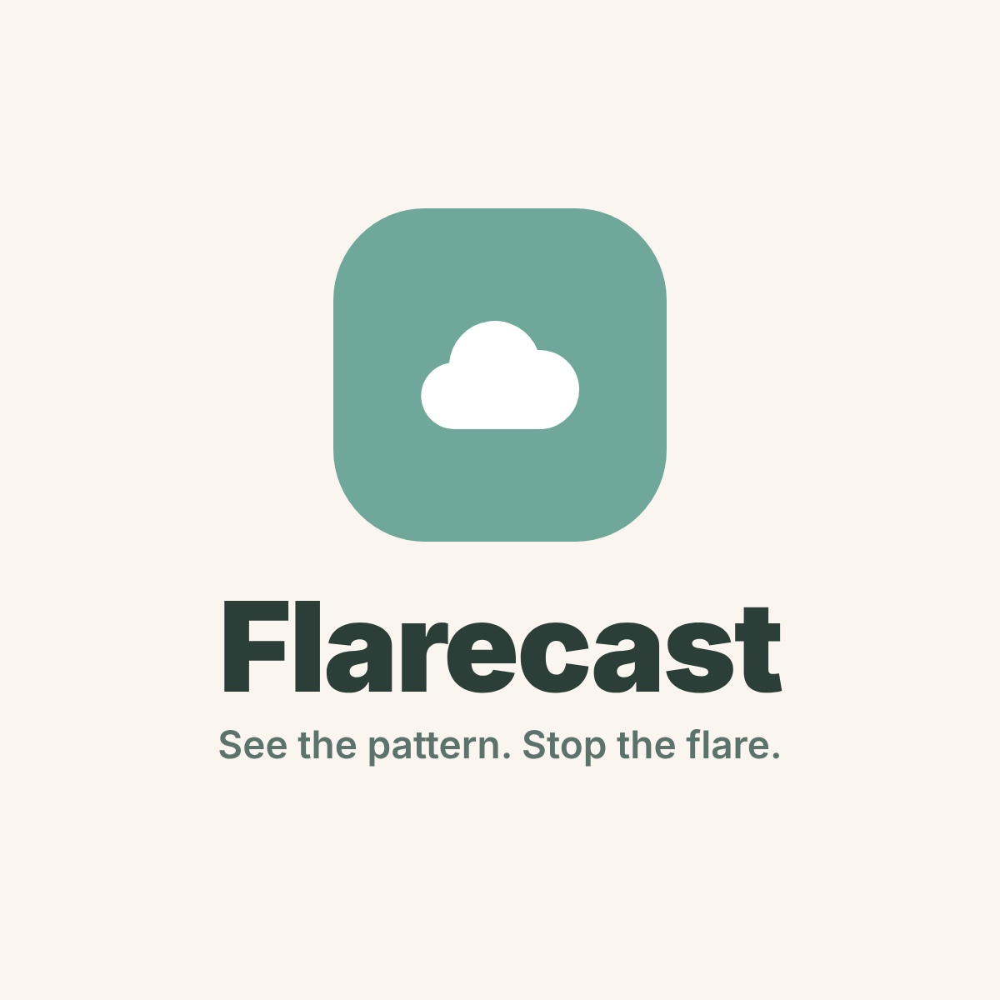
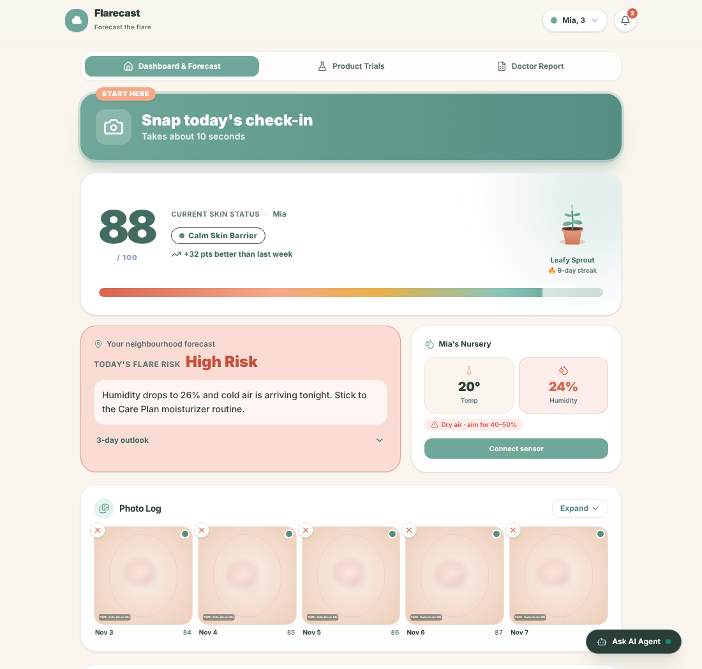
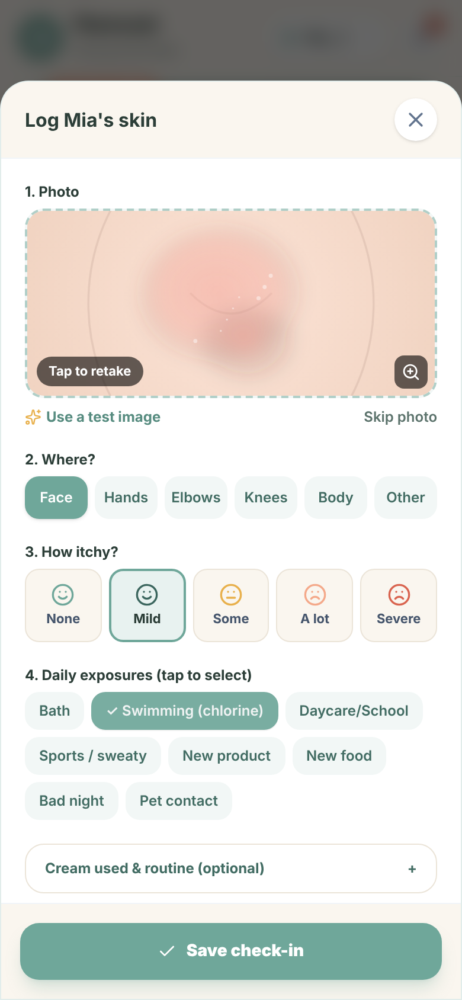
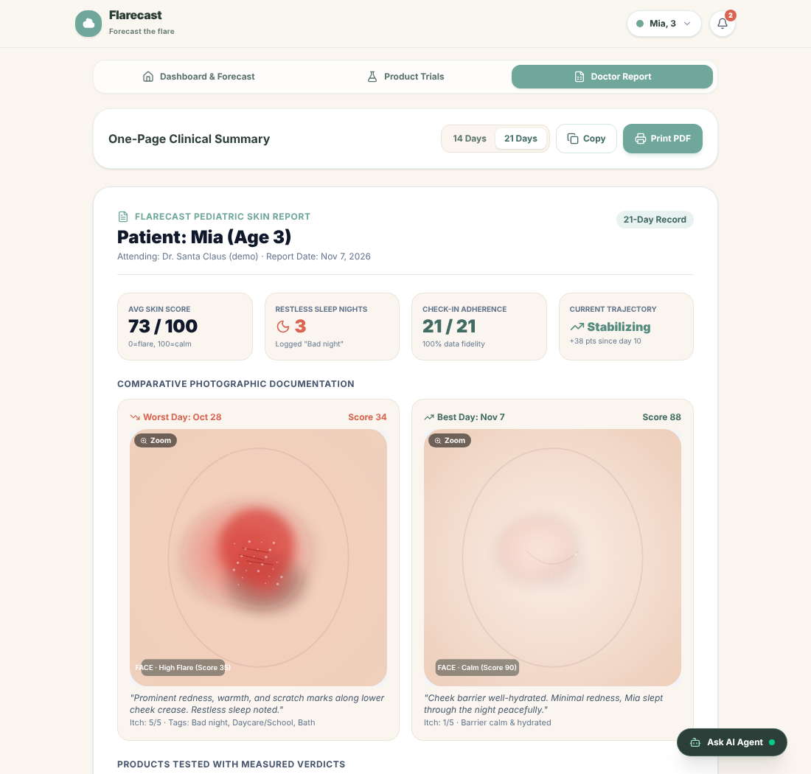

<p align="center">
  
</p>

<h1 align="center">Flarecast</h1>

<p align="center"><strong>See the pattern. Stop the flare.</strong></p>

<p align="center">
  🏆 <strong>2nd Place: Women in Engineering Hackathon 2026, University of Waterloo</strong><br/>
  Healthcare challenge judged by PointClickCare and Avanade
</p>

---

Flarecast helps parents of young children with eczema predict and prevent flares. A 10-second photo check-in becomes an AI skin check, a personal flare forecast and a one-page report that doctors can review in 30 seconds.



## The problem

Parents of young children with eczema can't tell what helps or worsens their child's skin, because their child can't explain symptoms and logging everything takes too much effort. As a result, they waste money on ineffective products and keep guessing at triggers.

- About **1 in 7** Canadian children and teens have documented eczema
- Families spend a median of **US $600 a year** out of pocket on eczema care
- The average wait to see a dermatologist in Canada is **5 months**
- Daily symptom diaries drop to **60%** completion within weeks, so most tracking tools get abandoned

## How it works

Flarecast connects the two sides of eczema care: what parents see at home and what doctors need in the clinic.

| | Parent | Doctor |
|---|---|---|
| **Input** | 10-second check-in: photo, where, how itchy, today's exposures | — |
| **Insight** | Skin Score, flare forecast, next steps, Care Plan reminders | One-page report with trends, best/worst photos and product verdicts |
| **Action** | Prevent flares, test products fairly, get same-day care for red flags | Make decisions from months of real data instead of memory |

<p align="center">
  
</p>

## Features

- **10-second check-in:** tap-anywhere photo, body area, itch level and daily exposures (including swimming and daycare/school), all on one screen with no typing
- **AI skin check:** Gemini Vision scores redness, swelling and scratch marks (0–3), writes a plain-language description and combines it with the parent's itch rating into a 0–100 Skin Score
- **Next steps:** clear actions after every check-in that adapt to the result and the day's exposures, from "keep your routine" to "contact your doctor today"
- **Red Flag Alerts:** signs of infection (oozing, yellow crusts, spreading blisters, fever) skip the score and route families to same-day care
- **Flare Forecast:** Low / Moderate / High risk based on the child's recent trend, local weather and indoor humidity
- **Indoor humidity sensor:** an ESP32 + DHT22 device streams live nursery temperature and humidity to the app; dry air raises the forecast
- **Product Trials:** test one cream at a time and get a verdict: helped, no change or worse
- **Care Plan:** the doctor's routine, editable by parents, with reminders when risk rises
- **Doctor Report:** a printable one-page clinical summary for appointments
- **AI Care Assistant and audio summaries:** a context-aware chatbot and a spoken daily briefing for busy, tired parents
- **Motivation without guilt:** a growing plant and streak that never punish missed days



## Tech stack

| Area | Technologies |
|---|---|
| Frontend | React, TypeScript, Vite, Tailwind CSS |
| Backend | Node.js, Express |
| AI | Google Gemini (`gemini-3.8-flash`): photo analysis with structured JSON output, care assistant, audio summary scripts |
| Data | Open-Meteo weather API, browser localStorage |
| Hardware | ESP32, DHT22 temperature/humidity sensor, 16×2 I²C LCD |
| Connectivity | Web Serial API (USB), optional Bluetooth LE |
| Built with | Google AI Studio, Claude |

### How the Skin Score works

1. Gemini Vision returns redness, swelling and scratch scores (0–3), an overall status and any red flags, using a strict JSON schema.
2. The app calculates: `Score = 100 − (redness × 15) − ((itch − 1) × 12) − (scratches × 10)`, kept between 25 and 96.
3. If red flags are detected, the score is hidden and the app shows urgent-care guidance instead.
4. If the AI is unavailable, the check-in still saves with an itch-based estimate, so parents never lose a log.

## Run it locally

**Prerequisites:** Node.js 18+ and a [Gemini API key](https://aistudio.google.com/apikey).

```bash
git clone https://github.com/lilylu125/flarecast.git
cd flarecast
npm install
cp .env.example .env   # then set GEMINI_API_KEY in .env
npm run dev
```

Open the local URL printed in the terminal. The app loads with demo data for "Mia, 3" so every screen has something to show.

### Indoor sensor (optional)

Wiring, firmware and setup steps are in [`hardware/indoor-sensor/`](hardware/indoor-sensor/README.md). The live connection works in Chrome or Edge on a laptop.

## Safety

Flarecast supports decisions; it does not diagnose. Every AI output is framed as "worth discussing with your doctor", the app never recommends cutting foods or changing treatment, and the doctor phone number in the demo is a placeholder.

## What's next

1. Pilot with 10–20 families to measure logging consistency, flare days and money spent on products
2. Validate the AI skin scoring with a pediatric dermatologist
3. Expand to caregivers in long-term care, then clinics and hospitals
4. Integrate with EHRs so reports land directly in the patient's chart

## Team

Built in one day at the Women in Engineering Hackathon 2026, University of Waterloo.

- **Lily Lu**: team lead and presenter
- **Elim Shen**
- **Lily Bai**
- **Aileen Gao**
